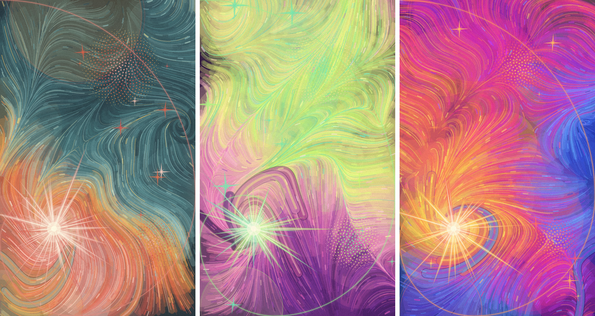
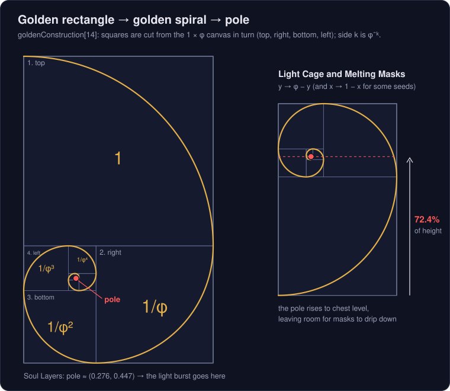
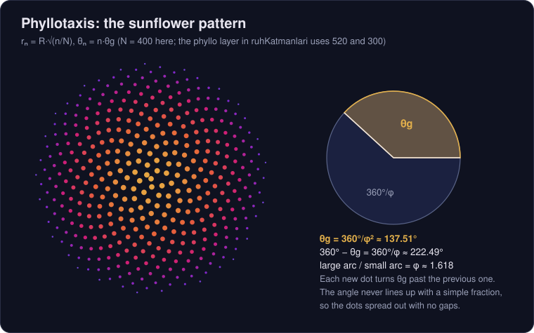
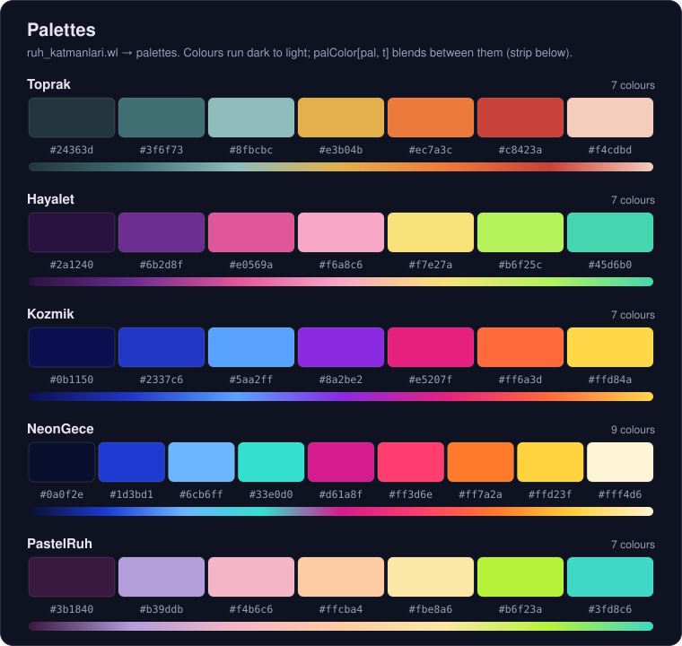
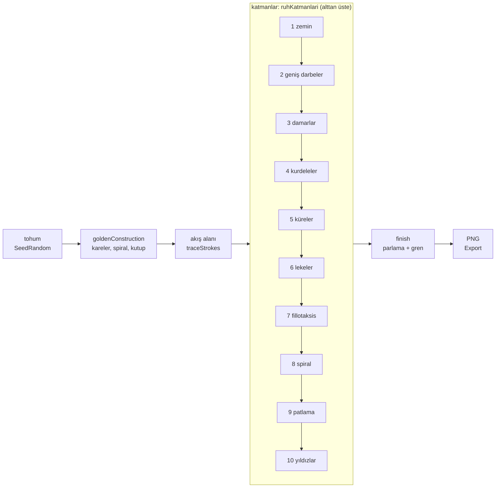

# Ruh Katmanları — Altın Oranla Kurulmuş Üretken Resim

> **English summary.** Generative paintings written in the Wolfram Language (Mathematica). Three modes — *Ruh Katmanları* (soul layers), *Işık Kafesi* (light cage) and *Eriyen Maskeler* (melting masks) — build layered, expressive brushwork whose whole composition is organised by the golden ratio: canvas proportions, spiral focus, vortex strengths, sizes and dot patterns. The code has passed a syntax check but has not yet been run in Mathematica; the documentation below is in Turkish.



*Python prototipinden önizleme; Mathematica çıktıları `calistir.wls` çalıştırıldığında `ciktilar/` klasörüne yazılır.*
*(Görseldeki üç pano Ruh Katmanları modunun Toprak, Hayalet ve Kozmik paletleridir; Mathematica çıktısı değildir.)*

Bu repo, ekspresyonist akrilik resimlerden esinlenen bir üretken sanat çalışması. Her resim binlerce fırça darbesinin bir akış alanını takip etmesiyle oluşur ve kompozisyonun her kararı altın orana bağlıdır: tuvalin oranı, odağın yeri, girdapların gücü, formların boyutu, noktaların dizilişi. Kod Wolfram Language ile yazıldı.

> [!IMPORTANT]
> **Durum:** Kod sözdizimi kontrolünden geçti (parantez dengesi denetlendi) ama henüz Mathematica'da çalıştırılmadı. İlk gerçek çıktılar `calistir.wls` ile alınacak.

## Modlar

`ruh_katmanlari.wl` üç mod içerir. Hepsi aynı altın dikdörtgen yapısını, aynı akış alanını (`traceStrokes`) ve aynı son işlemi (`finish`) paylaşır; her biri `Graphics` döndürür.

| Mod | Fonksiyon | Varsayılan palet | Görsel özellikler | Altın oran nerede |
|---|---|---|---|---|
| Ruh Katmanları (Bölüm 4) | `ruhKatmanlari[tohum, palet, girdap, yoğunluk, kılavuz]` | Kozmik | Akan fırça darbeleri, üst üste binen saydam küreler, kutupta ışık patlaması, noktalı dokular, dört kollu yıldızlar | Patlama spiralin kutbunda; girdap güçleri 1, 1/φ, 1/φ²; küre yarıçapları her adımda φ'ye bölünür; fillotaksis altın açıyla; yıldız boyutları φ'nin kuvvetleri |
| Işık Kafesi (Bölüm 10) | `isikKafesi[tohum, palet, yoğunluk, kılavuz]` | NeonGece | Kobalt kaburga kafesi ve omurga, sarı-macenta neon hale, göğüste altın-beyaz ışık patlaması, DNA benzeri sarmal dokular, köşelerde sivri yıldızlar | Yapı aynalanır, kutup yüksekliğin %72.4'üne çıkar; omurlar φ^(-1/8) oranıyla küçülür; kaburgalar φ kuvvetleriyle kısalır ve sıklaşır; ışınlar altın açının katlarında |
| Eriyen Maskeler (Bölüm 11) | `eriyenMaskeler[tohum, palet, yoğunluk, kılavuz]` | PastelRuh | Pastel sisli zemin, kenarlarda patlıcan moru girdaplar, 3-5 asit yeşili / turkuaz hayalet maske (biri koyu mor ve tek mavi gözlü), aşağı akan damlalar, `smear` ile yağlıboya sürüntüsü | Aynı aynalama; en büyük maske kutupta, diğerleri spiral üzerinde, yarıçaplar φ'ye bölünür; zemin girdapları kenarların 0.382 / 0.618 noktalarında, güçleri 1 … 1/φ³ |

`kaos_ve_form.wl` ayrı, daha eski bir çalışma: matematiksel formlardan oluşan bir galeri.

| Bölüm | Ne üretir | Kod |
|---|---|---|
| 1. Clifford çekicisi | İki trigonometrik denklemin milyonlarca yinelemesi; ziyaret sayıları logaritmik ölçekle renge çevrilir | `cliffordPoints`, `attractorArt`, `gradients` (Ateş, Okyanus, Aurora, Gün batımı), `art1`–`art3` |
| 2. Karmaşık düzlem | (z⁵ − 1)/(z² + 0.3i) + sin(1/z) fonksiyonunun alan renklendirmesi | `ComplexPlot`, `art4` |
| 3. Gyroid küre | sin x cos y + sin y cos z + sin z cos x = 0 yüzeyi, bir küreyle kırpılmış | `ContourPlot3D`, `art5` |
| 4. Canlı stüdyo | Çekicinin a, b, c, d parametreleri, nokta sayısı, palet ve parlaklık için kaydırıcılar | `Manipulate` |
| 6. Animasyonlar | Nefes alan gyroid, dönüşen Clifford çekicisi, dönen karmaşık düzlem; MP4 dışa aktarma | `gyroidFrame`, `cliffordFrame`, `complexFrame`, `exportVideo` |

## Altın oran matematiği

Aşağıdaki her formülün altında kodda nerede kullanıldığı yazıyor. Kod ile ideal formül arasında fark olduğunda kodu esas aldım.



**Altın oran**

$$
\varphi = \frac{1+\sqrt5}{2} \approx 1.618
$$

Tuval 1 × φ boyutunda dikey bir altın dikdörtgendir. Kodda: `phi = N[GoldenRatio]`, her modda `PlotRange -> {{0, 1}, {0, phi}}`.

**Altın açı**

$$
\theta_g = 2\pi\left(1-\frac{1}{\varphi}\right) = \pi(3-\sqrt5) \approx 137.5^\circ
$$

Tam turu φ oranında ikiye bölen küçük açı. Kodda: `goldenAngle = N[Pi (3 - Sqrt[5])]`; fillotaksis ve patlama ışınlarının açıları bunun katlarıdır.

**Altın spiral**

$$
r(\theta) = a\,\varphi^{2\theta/\pi}
$$

Her çeyrek turda yarıçap φ kat değişir. Kodda: `goldenConstruction[14]` tuvalden sırayla üst, sağ, alt, sol kare keser; k. karenin kenarı φ⁻ᵏ'dir. Spiral bu karelerin içine çizilen çeyrek daire yaylarından oluşur, yani formülün yaylarla yaklaşımıdır. Kesimler kutba yakınsar: Ruh Katmanları'nda kutup ≈ (0.276, 0.447).

**Aynalama (Işık Kafesi ve Eriyen Maskeler)**

$$
(x, y) \mapsto (x,\ \varphi - y) \qquad \text{ya da tohuma göre} \qquad (1-x,\ \varphi - y)
$$

Kutbun yüksekliği 0.447 / φ ≈ %27.6'dan 1 − 0.276 ≈ %72.4'e çıkar. Kodda: `ayna[{x_, y_}] := {If[flip, 1 - x, x], phi - y}`.



**Fillotaksis**

$$
r_n = R\sqrt{n/N},\quad \theta_n = n\,\theta_g
$$

Ayçiçeği tohumları gibi dizilim: noktalar eşit yoğunlukla yayılır, hiç üst üste binmez. Kodda: `phyllo` katmanı (`rr = R Sqrt[i/m]`, `th = i goldenAngle`); iki küme, merkezleri altın bölüm çizgilerinin kesişiminde: (0.618, 0.786 φ), R = 0.2, N = 520 ve (0.786, 0.236 φ), R = 0.15, N = 300.

**Girdap güçleri**

Ruh Katmanları ve Işık Kafesi'nde üç girdap var: biri kutupta, ikisi spiral üzerinde (`sp[[61]]`, `sp[[201]]`). Güçleri $1,\ 1/\varphi,\ 1/\varphi^2$, dönüş yönleri +, −, +. Kodda: `vs = {1., 1/phi, 1/phi^2}`, `vd = {1., -1., 1.}`. Eriyen Maskeler'de dört kenar girdabı var: güçleri `vs = 1./phi^Range[0, 3]`, yönleri +, −, +, −.

**Omur boyutu (Işık Kafesi)**

$$
s_k = s_0\,\varphi^{-k/8}
$$

Omurlar aşağıdan yukarıya bu oranla küçülür; her 8 omurda bir boyut tam φ'ye bölünür. Her adımda φ'ye bölmek omurgayı 4-5 omurda bitirirdi, o yüzden φ^(-1/8) seçildi. Kodda: `q = phi^(-1/8)`, `nOmur = 20`, `omurH = h0 q^Range[0, nOmur - 1]`; `h0` geometrik toplam omurgayı tam dolduracak şekilde seçilir: `h0 = (yUst - yAlt) (1 - q)/(1 - q^nOmur)`.

**Kaburga uzunluğu (Işık Kafesi)**

$$
w_j = w_{max}\,\varphi^{-|j|/2}, \qquad j = -4, \dots, 4
$$

Ortadaki kaburgalar en uzun; uçlara doğru φ kuvvetleriyle kısalır. Komşu çiftler arası da $d_0\,\varphi^{-(|j|-1/2)/2}$ ile daralır. Kodda: `kaburgaW = wMax phi^(-Abs[Range[-m, m]]/2)`, `wMax = 0.29`, `d0 = 0.15`, `m = 4`.

**Saydam küre yarıçapları (Ruh Katmanları)**

$$
r_k = r_0\,\varphi^{-k}, \qquad r_0 = 0.34,\ k = 0, \dots, 6
$$

Spiral boyunca dizilen yedi kürenin her biri bir öncekinin 1/φ'si kadar. Kodda: `bubbles` katmanı, `r = 0.34/phi^(k[[1]] - 1)`. Eriyen Maskeler'deki maske yarıçapları da aynı kuralla küçülür: `r0 = 0.21/phi^Range[0, …]`.

**Maske silüeti (Eriyen Maskeler)**

$$
r(\theta) = r_0\left(1+\sum_{k=2}^{5} a_k \sin(k\theta+\phi_k)\right)
$$

Gürültüyle bozulmuş kapalı eğri. Kodda: `sekil[s]`; `a` değerleri 0.03–0.12 arasından seçilip {1, 1.3, 1.7, 2.2}'ye bölünür. Nokta `r(θ) · (0.82 cos θ + σ·y(θ), y(θ))` olarak yerleşir, burada $y(\theta) = (1.12 - 0.28\sin\theta)\sin\theta$: alt yarı uzar, yüz daralır, σ ile yamulur, sonra hafifçe döndürülür.

**Akış alanı**

Her fırça darbesi bir noktadan başlayıp bu vektör alanını adım adım takip eder. Önce koordinatlar sinüslerle bükülür (alan bükme), sonra gürültü bir açıya çevrilir ve girdaplar eklenir. $p_1, p_2, p_3$ her tohumda rastgele seçilen fazlardır.

$$
\tilde x = x + 0.22\sin(3.3\,y + p_1), \qquad \tilde y = y + 0.22\sin(2.9\,x + p_2)
$$

$$
n = \sin(4.1\,\tilde x + p_3) + \cos(3.4\,\tilde y - p_1) + 0.6\sin\big(8.5(\tilde x - 0.7\,\tilde y) + p_2\big)
$$

$$
\mathbf v = \big(\cos 1.4n,\ \sin 1.4n\big) + \sum_j g_j\,\big(\cos\alpha_j,\ \sin\alpha_j\big)
$$

$$
g_j = 2.2\,S\,s_j\,e^{-r_j/(0.5\sqrt{s_j})}, \qquad \alpha_j = \mathrm{atan2}(\Delta y_j, \Delta x_j) + d_j\left(\frac{\pi}{2} + 0.3\right)
$$

$$
\mathbf p_{k+1} = \mathbf p_k + \Delta t\,\frac{\mathbf v}{\lVert \mathbf v \rVert}
$$

$r_j$ noktanın j. girdap merkezine uzaklığı (+0.001), $s_j$ ve $d_j$ girdabın gücü ve yönü, $S$ girdap çarpanıdır (Ruh Katmanları'nda `girdap` kaydırıcısı, Işık Kafesi'nde 1, Eriyen Maskeler'de 0.8). Kodda: `traceStrokes` (derlenmiş `Compile`).

**Parlama (ekran karışımı)**

$$
I = 1-(1-a)(1-g\,b)
$$

$a$ resmin kendisi, $b$ onun bulanık kopyası (`GaussianFilter`, yarıçap px/35), $g$ parlama miktarı. Parlak bölgeler çevresine ışık saçar. Kodda: `finish[g, px, glowAmt, grain]`; sonuca σ = 0.024'lük gren eklenip [0, 1] aralığına kırpılır. Parlama varsayılanı 0.3; Işık Kafesi'nde 0.4, Eriyen Maskeler'de 0.2.

## Paletler

Her palet koyudan açığa dizilmiş renklerden oluşur; `palColor[pal, t]` 0 ile 1 arasındaki her t için renkler arasında geçiş yapar. Hex kodları `ruh_katmanlari.wl` dosyasından okunarak çizildi.



| Palet | Renkler | Hangi modda |
|---|---|---|
| Toprak | Koyu deniz yeşili, su yeşili, hardal, turuncu, kiremit, ten pembesi: toprak ve kil | Ruh Katmanları örneği (`eser1`) |
| Hayalet | Mürdüm, mor, pembe, açık pembe, açık sarı, asit yeşili, turkuaz: gece yarısı neonu | Ruh Katmanları örneği (`eser2`) |
| Kozmik | Gece mavisi, kobalt, gök mavisi, menekşe, macenta, turuncu, sarı: uzay ve yıldız ışığı | `ruhKatmanlari` varsayılanı (`eser3`) |
| NeonGece | Koyu lacivert, kobalt, açık mavi, turkuaz, macenta, sıcak pembe, turuncu, sarı, altın-beyaz: neon anatomi | `isikKafesi` varsayılanı |
| PastelRuh | Patlıcan moru, lila, toz pembe, şeftali, tereyağı sarısı, asit yeşili, turkuaz: sisli rüya | `eriyenMaskeler` varsayılanı |

Stüdyoda her palet her modla kullanılabilir.

## Üretim hattı

Bir eser tohumdan PNG'ye şu sırayla gider. Katmanlar alttan üste çizilir: listedeki sıra resimdeki derinliktir, sonra çizilen öne geçer.



Diğer iki modun katman sırası:

| Mod | Katmanlar (alttan üste) | Son işlem |
|---|---|---|
| Işık Kafesi | zemin, geniş darbeler, damarlar, kalın sıcak darbeler, kısa çizgiler, sarmal dokular, yıldızlar, omurlar, kaburgalar, göğüs kemiği, ışık patlaması | `finish` (parlama 0.4) |
| Eriyen Maskeler | zemin, sis, geniş darbeler, orta darbeler, maskeler (küçükten büyüğe; en büyüğü en önde), üst sis | `finish` (parlama 0.2), ardından `smear` |

`smear[görüntü, kayma, bulanıklık]` yağlıboya sürüntüsü verir: pikseller düşük frekanslı bir gürültü alanına göre birkaç piksel kaydırılır, sonra dikey bir çizgi çekirdeğiyle (`ImageConvolve`) hafifçe bulanıklaştırılır. Her moda uygulanabilir.

## Stüdyo kontrolleri

Bölüm 12'deki ortak `Manipulate` üç modu tek panelde toplar. Kaydırıcı bırakılınca resim yeniden çizilir.

| Kontrol | Aralık / seçenekler | Ne yapar |
|---|---|---|
| mod | Ruh Katmanları, Işık Kafesi, Eriyen Maskeler (varsayılan: Ruh Katmanları) | Çizilecek modu seçer |
| tohum | 1–500, adım 1 (varsayılan 11) | Rastgelelik tohumu; her sayı farklı bir resim |
| palet | Otomatik, Toprak, Hayalet, Kozmik, NeonGece, PastelRuh | Otomatik: modun kendi paleti (Kozmik / NeonGece / PastelRuh) |
| girdap (Ruh Katmanları) | 0–2.5 (varsayılan 1) | Girdapların gücü; yalnız Ruh Katmanları'nı etkiler |
| yoğunluk | 0.3–1.6 (varsayılan 1) | Fırça darbesi sayısı çarpanı |
| altın oran kılavuzu | açık / kapalı | Kareleri, spirali ve kutbu resmin üstüne çizer |
| önizleme | açık / kapalı (varsayılan açık) | Açık: modun önizleme yoğunluğuyla, son işlemsiz hızlı çizim. Kapalı: tam yoğunluk + son işlem, 700 px |
| Rastgele | düğme | 1–500 arasında rastgele bir tohum seçer |
| Kaydet (3000 px) | düğme | Modun HQ yoğunluğuyla 3000 px genişlikte, kılavuzsuz PNG'yi Masaüstüne yazar (ör. `eriyen_maskeler_PastelRuh_5.png`) |

Önizleme ve yüksek kalite ayarları her modda ayrı değişkenlerde durur:

| Mod | Önizleme | Yüksek kalite (HQ) |
|---|---|---|
| Ruh Katmanları | yoğunluk 0.35 | yoğunluk 1.4, 3000 px |
| Işık Kafesi | `kafesOnizleme`: yoğunluk 0.35, 600 px | `kafesHQ`: yoğunluk 1.4, 3000 px |
| Eriyen Maskeler | `maskeOnizleme`: yoğunluk 0.35, 600 px | `maskeHQ`: yoğunluk 1.4, 3000 px |

Stüdyoda yoğunluk kaydırıcısı bu değerlerle çarpılır. 3000 px genişlik, 300 dpi'da yaklaşık 25 × 40 cm baskıya karşılık gelir.

## Nasıl çalıştırılır

Kodu çalıştırmak için bir Wolfram çekirdeği gerekir. Üç yol var; etkileşimli stüdyo yalnızca ilkinde çalışır.

**1. Mathematica uygulaması**

`ruh_katmanlari.wl` dosyasını aç ve "Run All Code" düğmesine bas. Bölüm 12'deki stüdyo yalnızca Mathematica not defterinde (ya da Wolfram Cloud'da) etkileşimli çalışır.

**2. Wolfram Engine (ücretsiz) + terminal**

1. https://www.wolfram.com/engine/ adresinden Wolfram Engine'i indirip kur (kişisel ve geliştirici kullanımı için ücretsiz, Wolfram ID gerekir).
2. Terminalde bir kez `wolframscript` yazıp Wolfram ID ile giriş yap; çekirdek etkinleşir.
3. Test et:

   ```sh
   wolframscript -code 'Plus[1,1]'   # 2 yazmalı
   ```

4. Örnekleri üret:

   ```sh
   cd mathematica-sanat
   wolframscript -file calistir.wls
   ```

`calistir.wls` ana dosyayı yükler ve dokuz PNG'yi `ciktilar/` klasörüne yazar: Ruh Katmanları `eser1`–`eser3`, Işık Kafesi `kafes1`, `kafes2` ve kılavuz görünümü, Eriyen Maskeler `maske1`, `maske2` ve kılavuz görünümü. Yükleme sırasında bütün örnekler çizildiği için ilk çalıştırma birkaç dakika sürebilir. Terminalde `Manipulate` görünmez.

**3. VS Code**

Eklentiler bölümünden **Wolfram Language** (Wolfram Research) eklentisini kur: `.wl` dosyalarında renklendirme, tamamlama ve hata işaretleme sağlar. Kodu yine 2. yoldaki gibi terminalden çalıştırırsın. Resimleri editör içinde görmek istersen isteğe bağlı Jupyter yolu var:

```sh
pip3 install jupyter
git clone https://github.com/WolframResearch/WolframLanguageForJupyter
cd WolframLanguageForJupyter && ./configure-jupyter.wls add
```

Sonra VS Code'da bir `.ipynb` dosyası açıp "Wolfram Language" çekirdeğini seç ve not defteri repo klasöründeyken `Get["ruh_katmanlari.wl"]` ile dosyayı yükle. Grafikler resim olarak görünür, ama kaydırıcılar etkileşimli olmaz.

**Sürüm notu:** `ruh_katmanlari.wl` Mathematica 12 uyumlu yazıldı. `kaos_ve_form.wl` `ComplexPlot` için Mathematica 12, MP4 dışa aktarma için 12.1 ister. Wolfram Engine her zaman güncel sürümdür.

### Mathematica olmadan: Python sürümü

`python/` klasörü iki `.wl` dosyasının Python karşılığıdır; Wolfram çekirdeği gerekmez. Fonksiyon adları ve bölüm numaraları `.wl` dosyalarıyla aynıdır (`ruhKatmanlari` → `ruh_katmanlari`, `traceStrokes` → `trace_strokes` …).

```bash
python3 -m venv .venv
.venv/bin/pip install -r python/requirements.txt
.venv/bin/python python/calistir.py         # calistir.wls karşılığı → ciktilar/
.venv/bin/python python/calistir_kaos.py    # calistir_kaos.wls karşılığı → ciktilar/kaos/
```

| Dosya | Karşılığı | Not |
|---|---|---|
| `python/tuval.py` | `Graphics` + `Rasterize` | İlkeller sırayla kaydedilir, matplotlib (Agg) ile rasterleştirilir; kalınlıklar tuval genişliğine oranlı |
| `python/ruh_katmanlari.py` | `ruh_katmanlari.wl` | Üç mod, `finish`, `smear`; `traceStrokes` numpy ile bütün darbeleri aynı anda izler |
| `python/kaos_ve_form.py` | `kaos_ve_form.wl` | Clifford yinelemesi numba ile derlenir; gyroid pyvista (VTK) ile çizilir |

Farklar: rastgele sayı üreteci farklı olduğu için aynı tohum Mathematica'daki resmin aynısını vermez (kurallar aynıdır). `ComplexPlot`'un `"CyclicLogAbsArg"` renklendirmesi ve `"SunsetColors"` yaklaşık olarak yeniden kuruldu. Gyroid tek ana ışıkla aydınlatılır. `Manipulate` stüdyoları henüz taşınmadı.

## Dosya yapısı

| Dosya | Açıklama |
|---|---|
| `ruh_katmanlari.wl` | Ana dosya: üç mod, ortak fırça araçları, `smear`, ortak stüdyo |
| `kaos_ve_form.wl` | Clifford çekicisi, karmaşık düzlem, gyroid, canlı stüdyo ve animasyonlar |
| `calistir.wls` | `wolframscript` ile örnekleri `ciktilar/` klasörüne PNG olarak yazar |
| `mathematica_karmasik_formlar.pdf` | "Mathematica ile Karmaşık Formlar": örtük yüzeyler, süperformül, 3B çekiciler, ışık ve malzeme gibi ileri teknikler rehberi |
| `docs/onizleme.png` | Python prototipinden önizleme (Mathematica çıktısı değil) |
| `docs/*.svg` | README diyagramları: altın spiral, fillotaksis, paletler |
| `docs/araclar/diyagramlar.py` | SVG'leri yeniden üreten Python betiği (`python3 docs/araclar/diyagramlar.py`, yalnızca standart kütüphane) |
| `docs/notlar/` | Geliştirme notları ve talimatlar |
| `calistir_kaos.wls` | `wolframscript` ile `kaos_ve_form.wl` görsellerini ve animasyon GIF'lerini `ciktilar/kaos/` klasörüne yazar |
| `python/` | Mathematica gerektirmeyen Python sürümü (yukarıya bak) |
| `ciktilar/` | `calistir.wls` / `python/calistir*.py` çıktıları; git'e girmez |

## İlham ve özgünlük

Bu çalışma ekspresyonist akrilik resimlerin genel özelliklerinden esinlenir: akan, görünür fırça darbeleri, üst üste binen saydam katmanlar, neon renkler ve ışık patlamaları. Hiçbir eser kopyalanmadı; her kompozisyon tohum sayısından prosedürel olarak üretilir ve yapısını altın oran belirler.

## Yol haritası

1. Wolfram Engine ile ilk gerçek çıktıları almak (`calistir.wls`).
2. `docs/onizleme.png`'yi Mathematica çıktılarıyla değiştirmek.
3. Animasyon modu.
4. Baskı: 3000 px HQ çıktılarla 25 × 40 cm deneme baskıları.
