# Soul Layers: Generative Paintings Built on the Golden Ratio

Generative paintings written in the Wolfram Language (Mathematica), with a full Python port. A program lays down thousands of brush strokes that follow an invisible current, and the golden ratio φ ≈ 1.618 decides the whole composition: the shape of the canvas, where the eye lands, how strong the swirls are, how big each shape is and how the dots are arranged.

> [!TIP]
> **New to this? Start with the illustrated explainer:**
> ### 👉 [How Soul Layers Paints](https://claude.ai/artifact/CqNzTnHpzss1jV9bGp8cbv)
> It walks through every idea step by step, with diagrams and live demos you can play with: cut a golden rectangle into squares, change the sunflower angle, watch brush strokes follow the flow field, and drag the sliders of a chaotic attractor. You don't need any maths or coding background. The same page lives in this repo as [`docs/index.html`](docs/index.html).

<p align="center">
  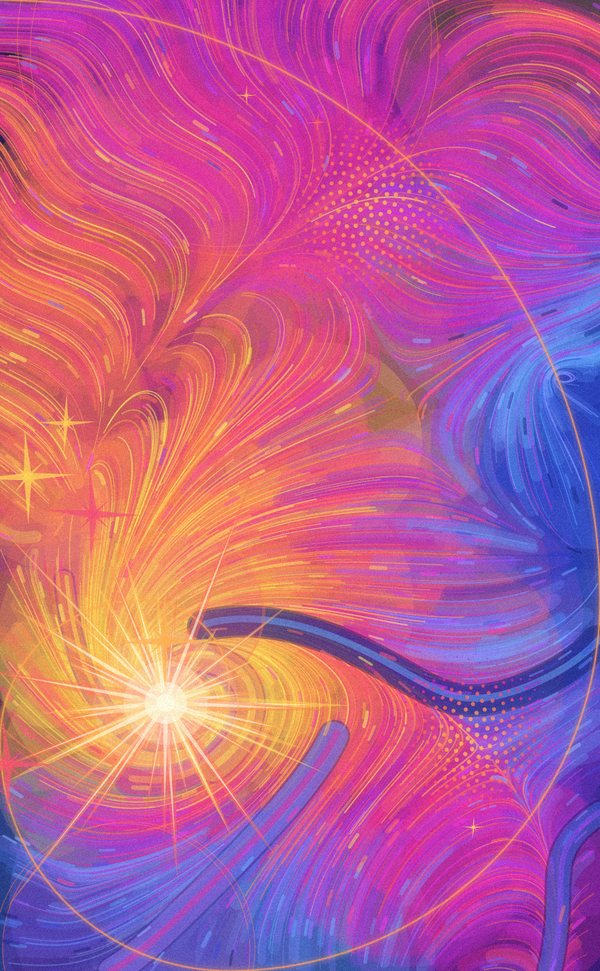
  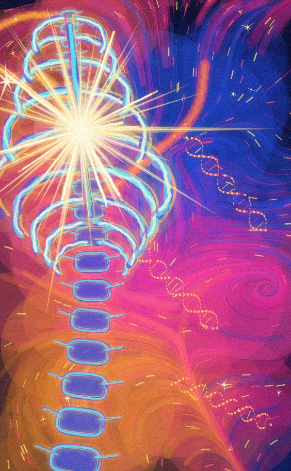
  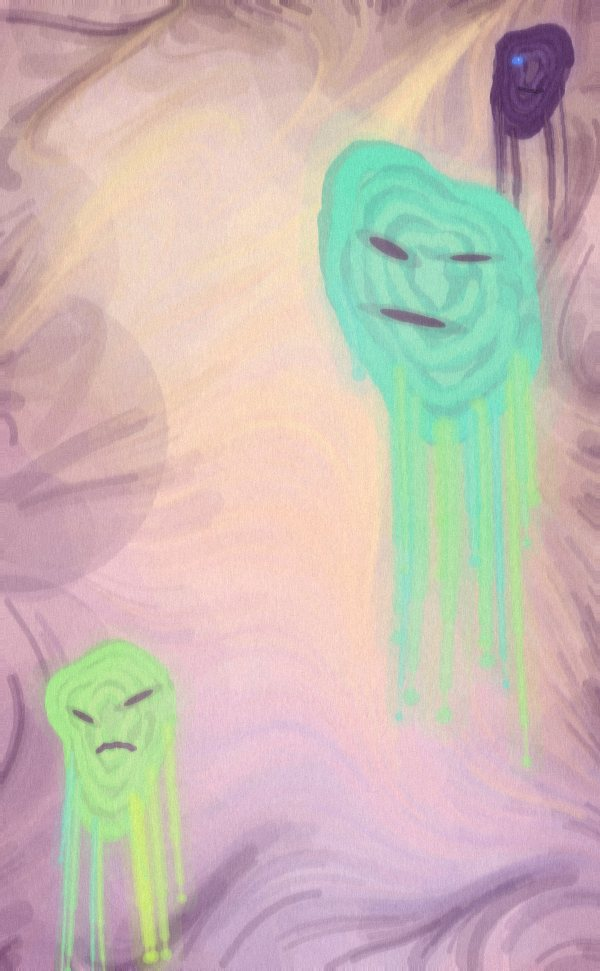
</p>
<p align="center"><sub>Soul Layers (seed 23) · Light Cage (seed 7) · Melting Masks (seed 18)</sub></p>

> [!IMPORTANT]
> **Status:** The Mathematica code passes a syntax check (bracket balance verified) but hasn't been run in Mathematica yet. **Every image in this README comes from the Python port** in [`python/`](python/), which follows the same rules. The first real Mathematica outputs will come from `calistir.wls`.

## Contents

- [How it works in one minute](#how-it-works-in-one-minute)
- [The three painting modes](#the-three-painting-modes)
- [Chaos and form: a second gallery](#chaos-and-form-a-second-gallery)
- [The golden ratio maths](#the-golden-ratio-maths)
- [Palettes](#palettes)
- [The pipeline](#the-pipeline)
- [Studio controls](#studio-controls)
- [How to run it](#how-to-run-it)
- [File layout](#file-layout)
- [Glossary of Turkish names](#glossary-of-turkish-names)
- [Inspiration and originality](#inspiration-and-originality)
- [Roadmap](#roadmap)

## How it works in one minute

1. **A seed.** Every painting starts from a whole number (11, 23, …). The seed drives all the random choices, so the same seed always gives the same painting.
2. **A golden layout.** The canvas is a 1 × φ rectangle. Squares are cut from it one after another, a golden spiral is drawn through them, and the point they shrink toward becomes the **pole**, where the eye goes first.
3. **A flow field.** Waves made of sines and cosines, plus three whirlpools placed on the spiral, define a direction at every point of the canvas.
4. **Layers of strokes.** Thousands of brush strokes each start somewhere and follow those directions step by step. Spheres, dots, stars, ribs or masks are painted on top, every size a power of φ.
5. **A finish.** A glow makes the bright areas leak light, a little grain is added, and the result is saved as a PNG.

## The three painting modes

All three live in `ruh_katmanlari.wl` ("soul layers"). They share the golden layout, the flow field (`traceStrokes`) and the finishing step (`finish`), and each returns a `Graphics` object. The right-hand image of each pair has the **golden guide** switched on, showing the squares, spiral and pole underneath.

| | Soul Layers | Light Cage | Melting Masks |
|---|---|---|---|
| Painting |  | 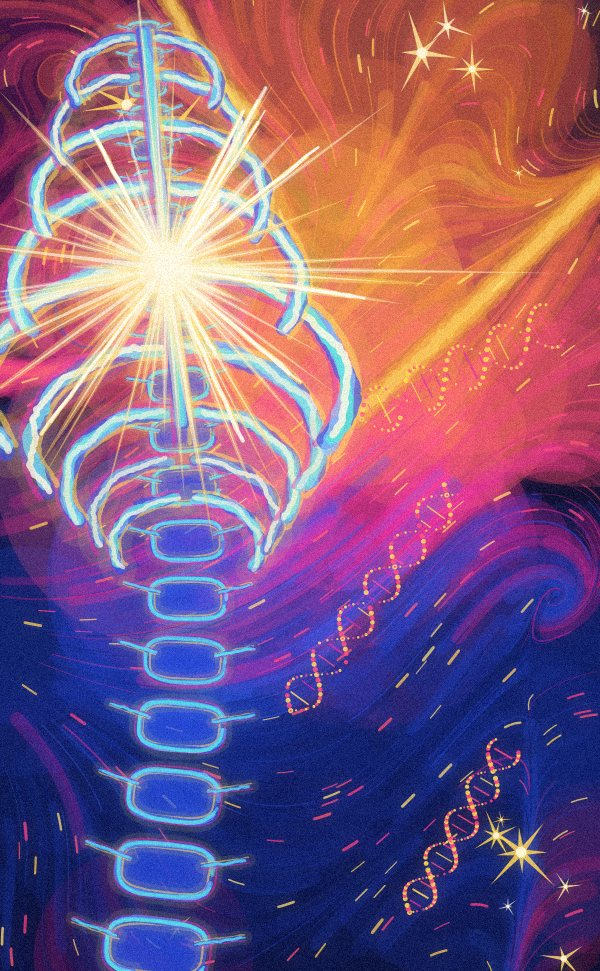 | 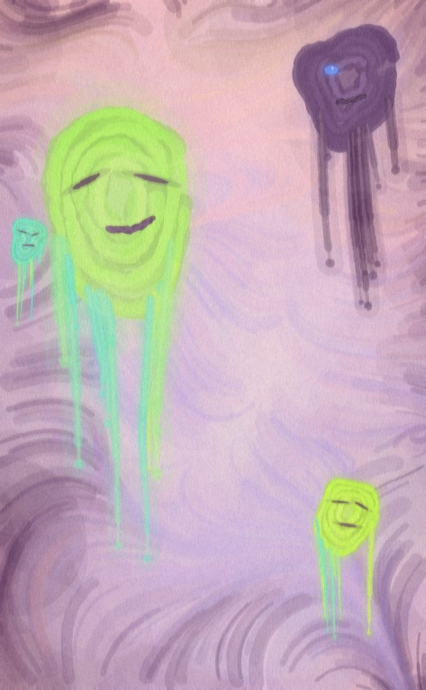 |
| Golden guide | 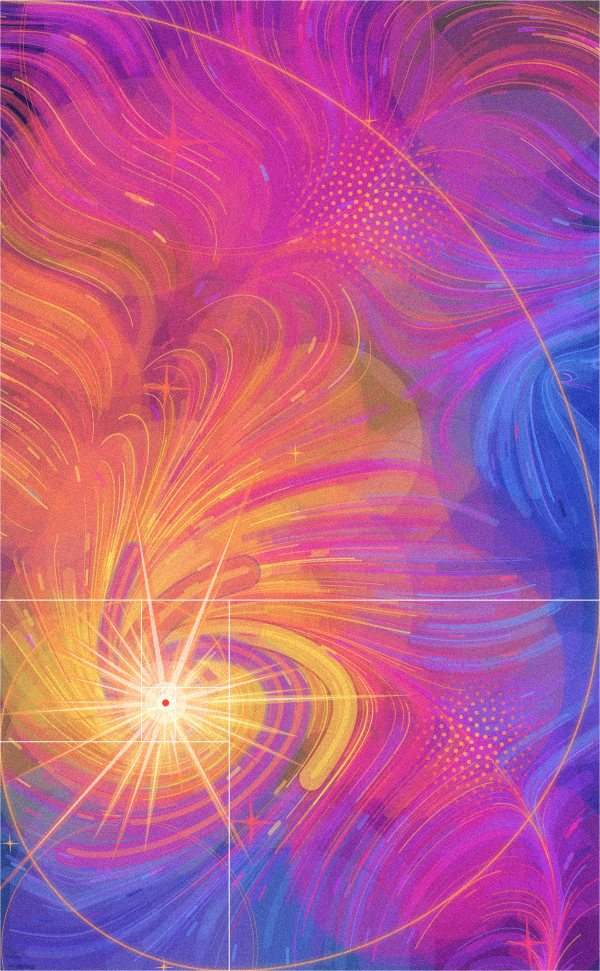 | 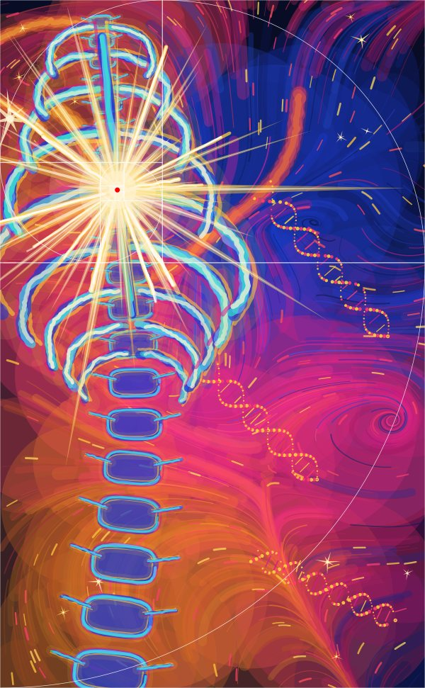 | 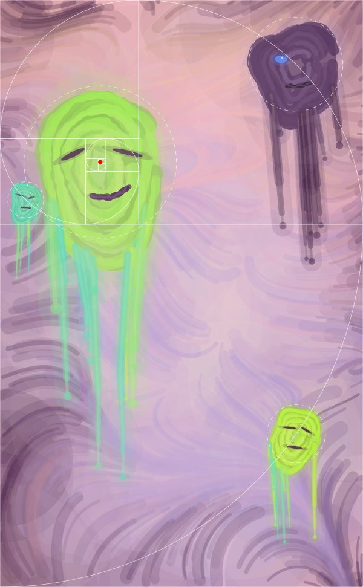 |

| Mode | Function | Default palette | What you see | Where φ is |
|---|---|---|---|---|
| Soul Layers (Section 4) | `ruhKatmanlari[seed, palette, swirl, density, guide]` | Kozmik | Flowing strokes, overlapping translucent spheres, a light burst at the pole, dotted textures, four-pointed stars | The burst sits on the spiral's pole; vortex strengths 1, 1/φ, 1/φ²; sphere radii divided by φ at each step; sunflower dots at the golden angle; star sizes are powers of φ |
| Light Cage (Section 10) | `isikKafesi[seed, palette, density, guide]` | NeonGece | A cobalt ribcage and spine, a yellow-magenta neon halo, a gold-white burst in the chest, DNA-like helices, sharp stars in the corners | The layout is mirrored so the pole rises to 72.4% of the height; vertebrae shrink by φ^(−1/8); ribs shorten and tighten by powers of φ; light rays at multiples of the golden angle |
| Melting Masks (Section 11) | `eriyenMaskeler[seed, palette, density, guide]` | PastelRuh | A misty pastel ground, aubergine swirls at the edges, 3–5 acid-green and turquoise ghost masks (one dark purple with a single blue eye), drips running down, an oil-paint smear from `smear` | Same mirroring; the biggest mask sits on the pole, the others on the spiral, each radius divided by φ; background vortices at the 0.382 / 0.618 points of the edges, strengths 1 … 1/φ³ |

<p align="center">
  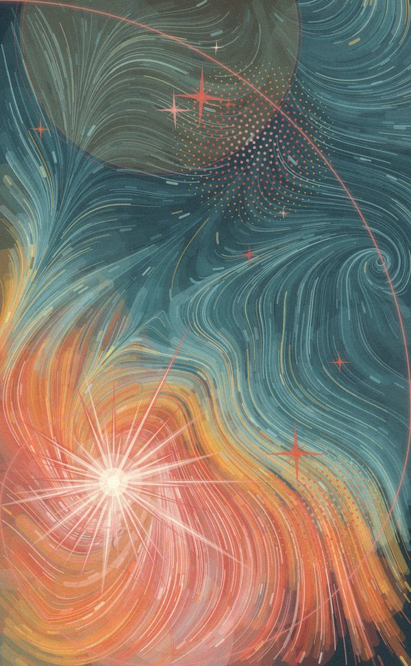
  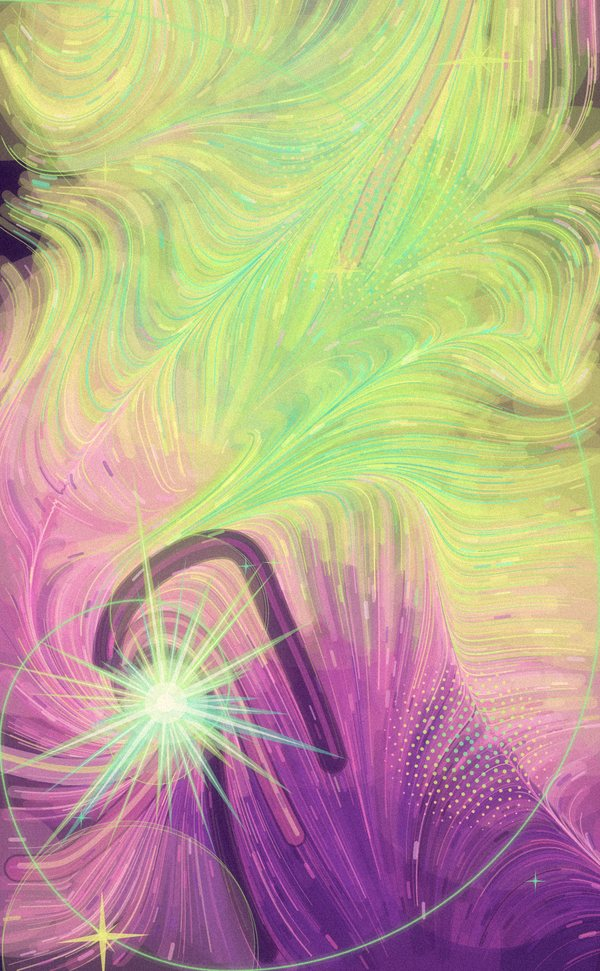
  
</p>
<p align="center"><sub>Soul Layers with the Toprak palette (seed 11) and the Hayalet palette (seed 4) · Melting Masks (seed 18)</sub></p>

## Chaos and form: a second gallery

`kaos_ve_form.wl` ("chaos and form") is a separate, earlier study: a gallery of shapes that come straight out of equations.

<p align="center">
  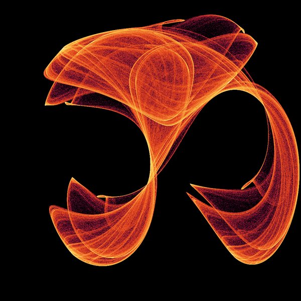
  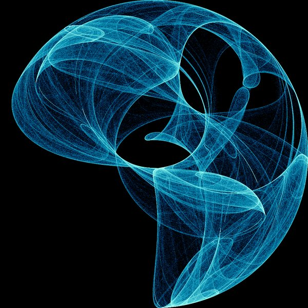
  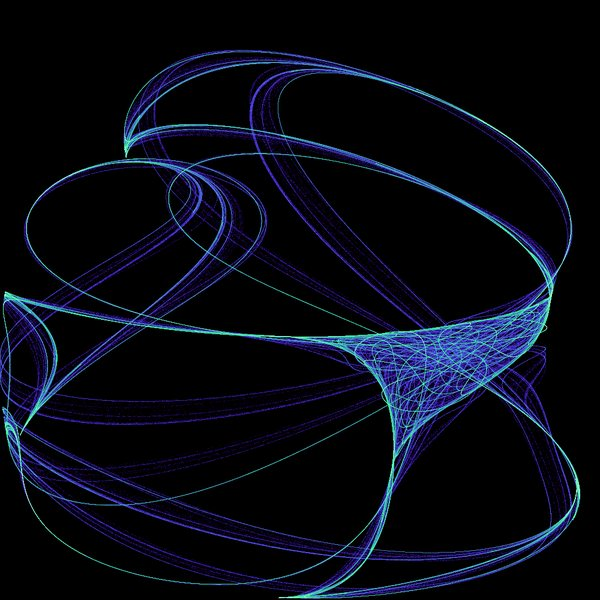
  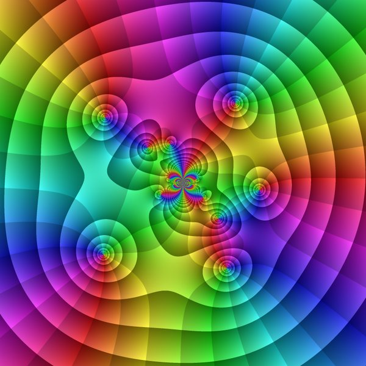
  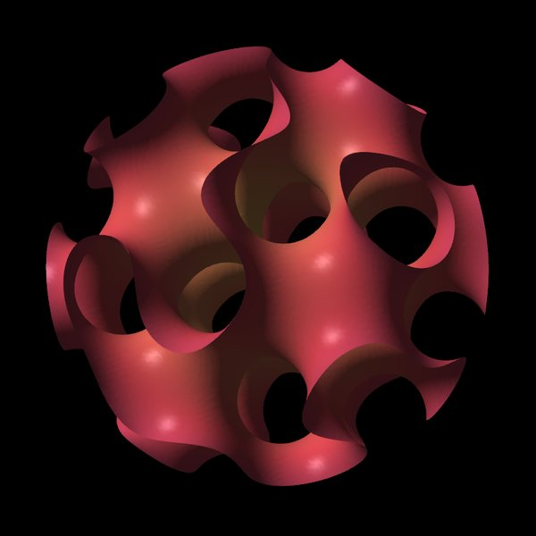
</p>
<p align="center"><sub>art1 · art2 · art3 (Clifford attractors) · art4 (complex plane) · art5 (gyroid)</sub></p>

| Section | What it makes | Code |
|---|---|---|
| 1. Clifford attractor | Millions of iterations of two trigonometric equations; how often each pixel is visited becomes colour on a log scale | `cliffordPoints`, `attractorArt`, `gradients` (Ateş/fire, Okyanus/ocean, Aurora, Gün batımı/sunset), `art1`–`art3` |
| 2. Complex plane | Domain colouring of f(z) = (z⁵ − 1)/(z² + 0.3i) + sin(1/z): hue shows the direction of f(z), bright rings show its size | `ComplexPlot`, `art4` |
| 3. Gyroid sphere | The surface sin x cos y + sin y cos z + sin z cos x = 0, cut by a sphere | `ContourPlot3D`, `art5` |
| 4. Live studio | Sliders for the attractor's a, b, c, d, the number of points, the palette and the brightness | `Manipulate` |
| 6. Animations | A breathing gyroid, a morphing Clifford attractor, a rotating complex plane; MP4 export | `gyroidFrame`, `cliffordFrame` (`cliffordBulut`, `yogunlukResmi`), `complexFrame`, `exportVideo` |

The Clifford attractor moves a single point with this rule, millions of times:

$$
x_{n+1} = \sin(a\,y_n) + c\cos(a\,x_n), \qquad y_{n+1} = \sin(b\,x_n) + d\cos(b\,y_n)
$$

The point never repeats, but it keeps coming back to the same invisible shape. Counting visits per pixel and colouring by the logarithm of the count turns that shape into a picture.

<p align="center">
  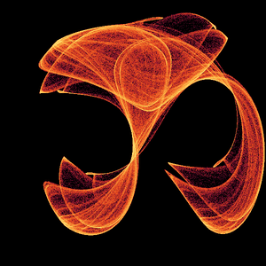
  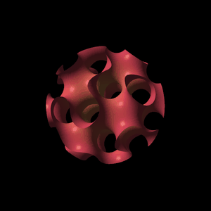
  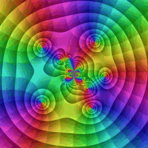
</p>
<p align="center"><sub>Clifford morph (art1 → art2 → art1) · breathing gyroid · rotating complex plane</sub></p>

**Why does the Clifford morph move points instead of parameters?** The first version slid art1's parameters linearly to art2's, and about 24 of the 60 frames came out black. The cause is in the maths. The symmetries of the Clifford map, (a, b, c, d) ≅ (a, b, −c, −d) ≅ (−a, −b, c, −d), all keep the sign of a·b. In art1 a·b < 0 and in art2 a·b > 0, so every parameter path between them crosses the plane a = 0 or b = 0. There one coordinate stops depending on the point's position, and the attractor collapses to a few points. Now the two attractors' points are each scaled to the same square, sorted by distance from their centre and paired up in that order, and every frame is drawn as a weighted average of the two clouds. No frame collapses: frame s = 0 is exactly art1 and frame s = 1/2 is exactly art2. For the same reason, the studio's "Random" button now redraws whenever it lands on a collapsed parameter set. The [explainer](https://claude.ai/artifact/CqNzTnHpzss1jV9bGp8cbv#morph) has a diagram of this.

## The golden ratio maths

Under each formula is where the code uses it. Where the code and the ideal formula differ, the code wins.


**The golden ratio**

$$
\varphi = \frac{1+\sqrt5}{2} \approx 1.618
$$

The canvas is a vertical 1 × φ golden rectangle. In the code: `phi = N[GoldenRatio]`, and every mode uses `PlotRange -> {{0, 1}, {0, phi}}`.

**The golden angle**

$$
\theta_g = 2\pi\left(1-\frac{1}{\varphi}\right) = \pi(3-\sqrt5) \approx 137.5^\circ
$$

The smaller of the two angles that split a full turn in the ratio φ. In the code: `goldenAngle = N[Pi (3 - Sqrt[5])]`; the phyllotaxis and the burst rays use multiples of it.

**The golden spiral**

$$
r(\theta) = a\,\varphi^{2\theta/\pi}
$$

The radius changes by a factor of φ every quarter turn. In the code: `goldenConstruction[14]` cuts squares from the canvas in turn (top, right, bottom, left); square k has side φ⁻ᵏ. The spiral is built from quarter-circle arcs inside those squares, an arc approximation of the formula. The cuts converge on the pole: in Soul Layers the pole is at ≈ (0.276, 0.447).

**Mirroring (Light Cage and Melting Masks)**

$$
(x, y) \mapsto (x,\ \varphi - y) \qquad \text{or, depending on the seed,} \qquad (1-x,\ \varphi - y)
$$

The pole's height goes from 0.447 / φ ≈ 27.6% to 1 − 0.276 ≈ 72.4%. In the code: `ayna[{x_, y_}] := {If[flip, 1 - x, x], phi - y}` (*ayna* = mirror).


**Phyllotaxis**

$$
r_n = R\sqrt{n/N},\quad \theta_n = n\,\theta_g
$$

The sunflower-seed arrangement: dots spread with even density and never overlap. In the code: the `phyllo` layer (`rr = R Sqrt[i/m]`, `th = i goldenAngle`). There are two patches, centred where the golden division lines cross: (0.618, 0.786 φ) with R = 0.2, N = 520, and (0.786, 0.236 φ) with R = 0.15, N = 300.

**Vortex strengths**

Soul Layers and Light Cage have three vortices: one on the pole and two on the spiral (`sp[[61]]`, `sp[[201]]`). Their strengths are $1,\ 1/\varphi,\ 1/\varphi^2$ and they spin +, −, +. In the code: `vs = {1., 1/phi, 1/phi^2}`, `vd = {1., -1., 1.}`. Melting Masks has four edge vortices with strengths `vs = 1./phi^Range[0, 3]` spinning +, −, +, −.

**Vertebra size (Light Cage)**

$$
s_k = s_0\,\varphi^{-k/8}
$$

Vertebrae shrink from bottom to top at this rate, so every 8 vertebrae the size drops by exactly φ. Dividing by φ at every step would have ended the spine after 4–5 vertebrae, hence φ^(−1/8). In the code: `q = phi^(-1/8)`, `nOmur = 20`, `omurH = h0 q^Range[0, nOmur - 1]`; `h0` is chosen so the geometric sum exactly fills the spine: `h0 = (yUst - yAlt) (1 - q)/(1 - q^nOmur)`.

**Rib length (Light Cage)**

$$
w_j = w_{max}\,\varphi^{-|j|/2}, \qquad j = -4, \dots, 4
$$

The middle ribs are the longest and shorten by powers of φ toward the ends. The gap between neighbouring pairs also narrows as $d_0\,\varphi^{-(|j|-1/2)/2}$. In the code: `kaburgaW = wMax phi^(-Abs[Range[-m, m]]/2)`, `wMax = 0.29`, `d0 = 0.15`, `m = 4`.

**Translucent sphere radii (Soul Layers)**

$$
r_k = r_0\,\varphi^{-k}, \qquad r_0 = 0.34,\ k = 0, \dots, 6
$$

Each of the seven spheres along the spiral is 1/φ the size of the previous one. In the code: the `bubbles` layer, `r = 0.34/phi^(k[[1]] - 1)`. The mask radii in Melting Masks shrink by the same rule: `r0 = 0.21/phi^Range[0, …]`.

**Mask outline (Melting Masks)**

$$
r(\theta) = r_0\left(1+\sum_{k=2}^{5} a_k \sin(k\theta+\phi_k)\right)
$$

A closed curve roughened by noise. In the code: `sekil[s]` (*şekil* = shape); the `a` values are drawn from 0.03–0.12 and divided by {1, 1.3, 1.7, 2.2}. Each point is placed at `r(θ) · (0.82 cos θ + σ·y(θ), y(θ))` with $y(\theta) = (1.12 - 0.28\sin\theta)\sin\theta$: the lower half is stretched, the face narrowed, skewed by σ and then rotated slightly.

**Flow field**

Every brush stroke starts at a point and follows this vector field step by step. First the coordinates are bent with sines (domain warping), then a noise value is turned into an angle and the vortices are added. $p_1, p_2, p_3$ are phases drawn at random from the seed.

$$
\tilde x = x + 0.22\sin(3.3\,y + p_1), \qquad \tilde y = y + 0.22\sin(2.9\,x + p_2)
$$

$$
n = \sin(4.1\,\tilde x + p_3) + \cos(3.4\,\tilde y - p_1) + 0.6\sin\big(8.5(\tilde x - 0.7\,\tilde y) + p_2\big)
$$

$$
\mathbf v = \big(\cos 1.4n,\ \sin 1.4n\big) + \sum_j g_j\,\big(\cos\alpha_j,\ \sin\alpha_j\big)
$$

$$
g_j = 2.2\,S\,s_j\,e^{-r_j/(0.5\sqrt{s_j})}, \qquad \alpha_j = \mathrm{atan2}(\Delta y_j, \Delta x_j) + d_j\left(\frac{\pi}{2} + 0.3\right)
$$

$$
\mathbf p_{k+1} = \mathbf p_k + \Delta t\,\frac{\mathbf v}{\lVert \mathbf v \rVert}
$$

$r_j$ is the distance from the point to vortex j (+0.001), $s_j$ and $d_j$ are the vortex's strength and direction, and $S$ is the vortex multiplier (the `swirl` slider in Soul Layers, 1 in Light Cage, 0.8 in Melting Masks). In the code: `traceStrokes` (a compiled `Compile` function).

**Glow (screen blend)**

$$
I = 1-(1-a)(1-g\,b)
$$

$a$ is the image itself, $b$ a blurred copy (`GaussianFilter`, radius px/35) and $g$ the glow amount. Bright areas spill light onto their surroundings. In the code: `finish[g, px, glowAmt, grain]`; grain with σ = 0.024 is then added and the result clipped to [0, 1]. The default glow is 0.3; Light Cage uses 0.4 and Melting Masks 0.2.

## Palettes

Each palette is a list of colours ordered from dark to light; `palColor[pal, t]` blends between them for any t from 0 to 1. The hex codes are read directly from `ruh_katmanlari.wl`.


| Palette | Colours | Used in |
|---|---|---|
| Toprak (*earth*) | Dark sea green, teal, mustard, orange, terracotta, skin pink: soil and clay | Soul Layers example (`eser1`) |
| Hayalet (*ghost*) | Plum, purple, pink, light pink, pale yellow, acid green, turquoise: midnight neon | Soul Layers example (`eser2`) |
| Kozmik (*cosmic*) | Midnight blue, cobalt, sky blue, violet, magenta, orange, yellow: space and starlight | `ruhKatmanlari` default (`eser3`) |
| NeonGece (*neon night*) | Dark navy, cobalt, light blue, turquoise, magenta, hot pink, orange, yellow, gold-white: neon anatomy | `isikKafesi` default |
| PastelRuh (*pastel soul*) | Aubergine, lilac, dusty pink, peach, butter yellow, acid green, turquoise: a misty dream | `eriyenMaskeler` default |

In the studio, any palette works with any mode.

## The pipeline

A painting goes from seed to PNG in this order. Layers are painted bottom to top: the order in the list is the depth in the picture, and later layers sit in front.

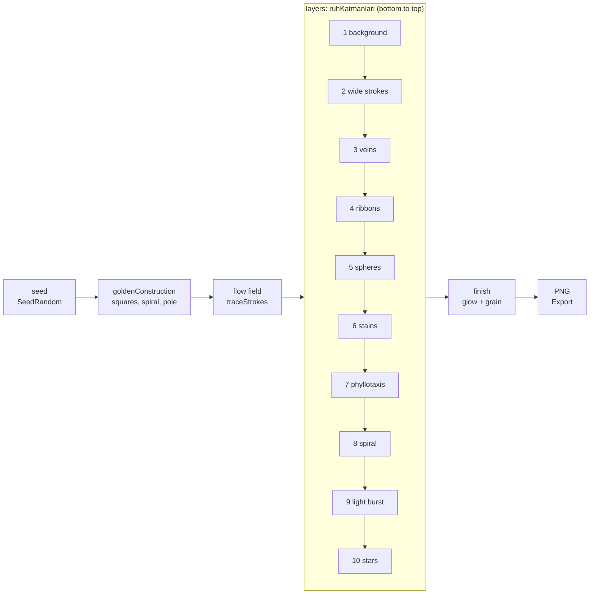

The layer order of the other two modes:

| Mode | Layers (bottom to top) | Finish |
|---|---|---|
| Light Cage | background, wide strokes, veins, thick warm strokes, short dashes, helix textures, stars, vertebrae, ribs, sternum, light burst | `finish` (glow 0.4) |
| Melting Masks | background, mist, wide strokes, medium strokes, masks (small to large; the largest in front), top mist | `finish` (glow 0.2), then `smear` |

`smear[image, shift, blur]` gives an oil-paint drag: pixels are displaced a few pixels along a low-frequency noise field, then softened with a vertical line kernel (`ImageConvolve`). It works on any mode.

## Studio controls

The shared `Manipulate` in Section 12 brings all three modes into one panel. The painting redraws when you release a slider.

| Control | Range / options | What it does |
|---|---|---|
| mode | Ruh Katmanları, Işık Kafesi, Eriyen Maskeler (default: Ruh Katmanları) | Picks the mode |
| seed (*tohum*) | 1–500, step 1 (default 11) | Random seed; every number is a different painting |
| palette | Otomatik (auto), Toprak, Hayalet, Kozmik, NeonGece, PastelRuh | Auto uses the mode's own palette (Kozmik / NeonGece / PastelRuh) |
| swirl (*girdap*, Soul Layers only) | 0–2.5 (default 1) | Vortex strength; only affects Soul Layers |
| density (*yoğunluk*) | 0.3–1.6 (default 1) | Multiplier for the number of brush strokes |
| golden guide (*altın oran kılavuzu*) | on / off | Draws the squares, spiral and pole on top of the painting |
| preview (*önizleme*) | on / off (default on) | On: fast draw at the mode's preview density, no finish. Off: full density + finish, 700 px |
| Random | button | Picks a random seed from 1–500 |
| Save (3000 px) | button | Writes a 3000 px PNG without the guide, at the mode's HQ density, to the Desktop (e.g. `eriyen_maskeler_PastelRuh_5.png`) |

Preview and high-quality settings live in separate variables per mode:

| Mode | Preview | High quality (HQ) |
|---|---|---|
| Soul Layers | density 0.35 | density 1.4, 3000 px |
| Light Cage | `kafesOnizleme`: density 0.35, 600 px | `kafesHQ`: density 1.4, 3000 px |
| Melting Masks | `maskeOnizleme`: density 0.35, 600 px | `maskeHQ`: density 1.4, 3000 px |

The studio's density slider is multiplied by these values. 3000 px wide is roughly a 25 × 40 cm print at 300 dpi.

## How to run it

### Without Mathematica: the Python port

The [`python/`](python/) folder is a Python version of both `.wl` files; no Wolfram kernel needed. Function names and section numbers match the `.wl` files (`ruhKatmanlari` → `ruh_katmanlari`, `traceStrokes` → `trace_strokes` …).

```bash
python3 -m venv .venv
.venv/bin/pip install -r python/requirements.txt
.venv/bin/python python/calistir.py         # same as calistir.wls → ciktilar/
.venv/bin/python python/calistir_kaos.py    # same as calistir_kaos.wls → ciktilar/kaos/
.venv/bin/python python/studyo.py           # shared studio (Section 12): three modes, slider window
.venv/bin/python python/studyo_kaos.py      # Clifford live studio (kaos_ve_form.wl Section 4)
```

| File | Counterpart | Notes |
|---|---|---|
| `python/tuval.py` | `Graphics` + `Rasterize` | Primitives are recorded in order and rasterised with matplotlib (Agg); line widths scale with canvas width |
| `python/ruh_katmanlari.py` | `ruh_katmanlari.wl` | The three modes, `finish`, `smear`; `trace_strokes` traces every stroke at once with numpy |
| `python/kaos_ve_form.py` | `kaos_ve_form.wl` | The Clifford iteration is compiled with numba; the gyroid is drawn with pyvista (VTK) |
| `python/studyo.py` | Section 12 `Manipulate` | Same controls; redraws when a slider is released, "Save" writes a 3000 px PNG to the Desktop |
| `python/studyo_kaos.py` | Section 4 `Manipulate` | 150,000-point preview while dragging, full quality on release; "Save" writes to the home folder |

Differences: the random number generator is different, so the same seed won't reproduce the Mathematica picture exactly (the rules are the same). `ComplexPlot`'s `"CyclicLogAbsArg"` colouring and `"SunsetColors"` are rebuilt approximately. The gyroid is lit by a single key light.

### With Mathematica

You need a Wolfram kernel. There are three ways; the interactive studio only works in the first.

**1. The Mathematica app**

Open `ruh_katmanlari.wl` and press "Run All Code". The studio in Section 12 is only interactive in a Mathematica notebook (or Wolfram Cloud).

**2. Wolfram Engine (free) + terminal**

1. Download and install Wolfram Engine from https://www.wolfram.com/engine/ (free for personal and developer use; needs a Wolfram ID).
2. Type `wolframscript` once in a terminal and sign in with your Wolfram ID to activate the kernel.
3. Test it:

   ```sh
   wolframscript -code 'Plus[1,1]'   # should print 2
   ```

4. Render the examples:

   ```sh
   cd mathematica-sanat
   wolframscript -file calistir.wls
   ```

`calistir.wls` loads the main file and writes nine PNGs into `ciktilar/`: Soul Layers `eser1`–`eser3`, Light Cage `kafes1`, `kafes2` and a guide view, Melting Masks `maske1`, `maske2` and a guide view. All examples are drawn while the file loads, so the first run can take a few minutes. `Manipulate` doesn't appear in the terminal.

**3. VS Code**

Install the **Wolfram Language** extension (by Wolfram Research): it adds highlighting, completion and error marking for `.wl` files. You still run the code from the terminal as in option 2. To see images inside the editor there's an optional Jupyter route:

```sh
pip3 install jupyter
git clone https://github.com/WolframResearch/WolframLanguageForJupyter
cd WolframLanguageForJupyter && ./configure-jupyter.wls add
```

Then open an `.ipynb` file in VS Code, pick the "Wolfram Language" kernel, and with the notebook in the repo folder load the file with `Get["ruh_katmanlari.wl"]`. Graphics show up as images, but sliders aren't interactive.

**Version note:** `ruh_katmanlari.wl` is written to be Mathematica 12 compatible. `kaos_ve_form.wl` needs Mathematica 12 for `ComplexPlot` and 12.1 for MP4 export. Wolfram Engine is always the latest version.

## File layout

| File | Description |
|---|---|
| `ruh_katmanlari.wl` | Main file: the three modes, shared brush tools, `smear`, the shared studio |
| `kaos_ve_form.wl` | Clifford attractor, complex plane, gyroid, live studio and animations |
| `calistir.wls` | Writes the examples to `ciktilar/` as PNGs with `wolframscript` |
| `calistir_kaos.wls` | Writes the `kaos_ve_form.wl` images and animation GIFs to `ciktilar/kaos/` with `wolframscript` |
| `mathematica_karmasik_formlar.pdf` | "Complex Forms with Mathematica" (in Turkish): a guide to advanced techniques such as implicit surfaces, the superformula, 3D attractors, light and materials |
| `python/` | The Python port that doesn't need Mathematica (see above) |
| `docs/index.html` | The illustrated explainer page ([live version](https://claude.ai/artifact/CqNzTnHpzss1jV9bGp8cbv)) |
| `docs/gallery/` | Web-sized images and GIFs used by this README and the explainer, rendered with the Python port |
| `docs/onizleme.png` | Early preview from the Python prototype (not Mathematica output) |
| `docs/*.svg` | README diagrams: golden spiral, phyllotaxis, palettes |
| `docs/araclar/diyagramlar.py` | Script that regenerates the SVGs (`python3 docs/araclar/diyagramlar.py`, standard library only) |
| `docs/notlar/` | Development notes and instructions (in Turkish) |
| `ciktilar/` | Output of `calistir.wls` / `python/calistir*.py`; not tracked by git |

## Glossary of Turkish names

The code and file names are in Turkish. The words you'll meet most often:

| Turkish | English |
|---|---|
| ruh katmanları | soul layers |
| ışık kafesi | light cage |
| eriyen maskeler | melting masks |
| kaos ve form | chaos and form |
| tohum | seed |
| palet | palette |
| girdap | vortex, swirl |
| yoğunluk | density |
| kılavuz | guide |
| önizleme | preview |
| kutup | pole |
| ayna | mirror |
| omur / kaburga | vertebra / rib |
| bulut | cloud (of points) |
| yoğunluk resmi | density image |
| çalıştır | run |
| çıktılar | outputs |
| stüdyo | studio |
| tuval | canvas |
| eser | artwork |

## Inspiration and originality

This work draws on the general traits of expressionist acrylic painting: flowing, visible brushwork, overlapping translucent layers, neon colour and bursts of light. No existing artwork was copied. Every composition is generated procedurally from its seed, and its structure comes from the golden ratio.

## Roadmap

1. Get the first real outputs with Wolfram Engine (`calistir.wls`).
2. Replace the Python-rendered images with Mathematica outputs.
3. An animation mode for the paintings.
4. Printing: 25 × 40 cm test prints from the 3000 px HQ outputs.
